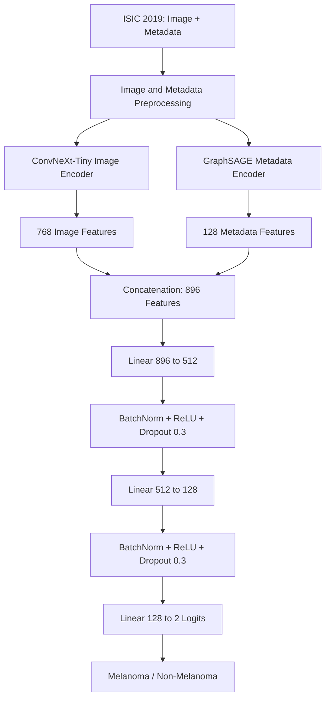

# Multimodal Skin Lesion Classification Using ConvNeXt-Tiny and GraphSAGE

A hybrid deep learning approach for **binary melanoma classification** using dermoscopic images and clinical metadata from the **ISIC 2019** dataset.

The project combines a **ConvNeXt-Tiny** image encoder with a **GraphSAGE** metadata encoder. Their learned representations are concatenated and passed to a fully connected classifier to predict **melanoma** or **non-melanoma**.

> **Research prototype:** This repository describes an academic experiment, not a validated medical diagnostic system. The reported metrics are preliminary *validation-set* results and should not be interpreted as independent clinical performance.

## Project Overview

Dermoscopy images contain information about lesion color, structure, borders, and texture, while clinical metadata provides additional context such as patient age, sex, and anatomical site. This project investigates whether combining these two modalities is useful for classifying melanoma.

**Key components**

- **Dataset:** ISIC 2019 dermoscopic images, image-level ground-truth labels, and metadata.
- **Target:** `1 = Melanoma (MEL)`, `0 = Non-Melanoma (all other ISIC 2019 diagnostic categories)`.
- **Visual encoder:** ImageNet-pretrained `convnext_tiny` (via `timm`).
- **Metadata encoder:** Two GraphSAGE layers (via PyTorch Geometric).
- **Fusion:** Concatenation of image and graph features.
- **Classifier:** Fully connected layers with batch normalization, ReLU, and dropout.

> **Terminology:** “Non-melanoma” is **not equivalent to “benign.”** The negative class contains all diagnoses other than melanoma, including other malignant conditions. Some notebook plots use the label “Benign”; interpret that class as **Non-Melanoma** under the implemented target mapping.

## Architecture



### Feature extractors

| Component | Architecture | Output |
|---|---|---|
| Image branch | ConvNeXt-Tiny backbone without its classification head | 768-dimensional vector |
| Metadata graph | Three nodes: age, sex, anatomical site; bidirectional edges between each pair | 3 nodes × 1 input feature |
| GraphSAGE | `SAGEConv(1, 32)` → ReLU → `SAGEConv(32, 64)` → ReLU | 64 features per node |
| Graph aggregation | Global mean pooling → `Linear(64, 128)` | 128-dimensional vector |
| Feature fusion | Concatenation (`768 + 128`) | 896-dimensional vector |
| Classification | `896 → 512 → 128 → 2`, BatchNorm, ReLU, Dropout `0.3` | Two logits |

**Graph construction:** Each dermoscopic image has its *own* three-node graph representing its metadata fields. The graph does **not** represent connections between different patients or lesions.

## Dataset and Preprocessing

The original notebook downloads the dataset using KaggleHub:

```python
import kagglehub
path = kagglehub.dataset_download("andrewmvd/isic-2019")
```

Dataset: [ISIC 2019 on Kaggle](https://www.kaggle.com/datasets/andrewmvd/isic-2019). For the original challenge and data acknowledgments, see the [ISIC Challenge](https://challenge.isic-archive.com/).

### Image preprocessing

1. Read each RGB dermoscopy image.
2. Remove hair artifacts using black-hat morphology and inpainting.
3. Apply CLAHE in LAB color space for contrast enhancement.
4. Resize to `224 × 224` pixels.
5. Normalize with ImageNet channel statistics.
6. During training, apply random horizontal/vertical flips, rotation, and brightness/contrast changes.

### Clinical metadata preprocessing

- Impute missing approximate age values using the median.
- Fill missing `sex` and `anatom_site_general` values with `unknown`.
- Label-encode sex and anatomical site.
- Standardize approximate age.
- Build a three-node, bidirectional metadata graph for each sample.

### Class imbalance handling

The current notebook uses `RandomUnderSampler` followed by `RandomOverSampler` and then performs a stratified 80/20 train–validation split.

**Methodological limitation:** Because resampling is performed *before* splitting, repeated samples can appear in both partitions. Metadata encoders and scaling are also fitted before the split. These steps can inflate validation metrics. A more rigorous version should split first (ideally by patient/lesion identifier where available), fit preprocessing only on training data, and resample **only the training partition**.

## Training Configuration

| Setting | Value in the notebook |
|---|---|
| Framework | PyTorch + PyTorch Geometric |
| Image backbone | ImageNet-pretrained ConvNeXt-Tiny |
| Input resolution | 224 × 224 |
| Batch size | 32 |
| Maximum epochs | 30 |
| Loss | Weighted CrossEntropyLoss |
| Optimizer | AdamW |
| Learning rate | `1e-4` (one optimizer-wide rate) |
| Weight decay | `1e-4` |
| Scheduler | ReduceLROnPlateau (validation ROC-AUC; factor 0.5, patience 2) |
| Early stopping | Patience 7 |
| Best-checkpoint criterion | Highest validation ROC-AUC |
| Checkpoint filename | `best_model.pth` |

The saved checkpoint contains a PyTorch `state_dict`, which is loaded into the same architecture for evaluation.

## Preliminary Validation Results

Results below are taken from the project's shared classification report and confusion matrix, **not from an independent held-out test set**.

| Metric | Reported validation result |
|---|---:|
| Accuracy | **92.59%** |
| Balanced accuracy | **92.59%** |
| Melanoma precision | 90% |
| Melanoma recall (sensitivity) | 95% |
| Melanoma F1-score | 93% |
| Macro-average F1-score | 93% |
| Specificity (non-melanoma recall) | 89.83% |
| Matthews correlation coefficient (MCC) | 0.853 |
| Correct predictions | 3,350 / 3,618 |

**Validation confusion matrix** (rows = actual, columns = predicted):

| Actual / Predicted | Non-Melanoma | Melanoma |
|---|---:|---:|
| Non-Melanoma | 1,625 | 184 |
| Melanoma | 84 | 1,725 |

The notebook also generates a classification report, precision–recall curve, calibration curve, and confusion matrix. The precision–recall **curve** is plotted, but a numerical average-precision/PR-AUC value is not recorded in this notebook; no such number is claimed here.

> **Interpretation caution:** Validation accuracy may be optimistic because of sampling-before-splitting and preprocessing leakage. Do not use these metrics to claim clinical readiness or generalization to new patients. Repeat evaluation with a leakage-free split and an untouched test set before publication-quality comparisons.

## Tech Stack

- **Language:** Python
- **Deep learning:** PyTorch, `timm`, PyTorch Geometric (`SAGEConv`)
- **Computer vision:** OpenCV, Albumentations
- **Data handling:** NumPy, Pandas
- **Machine learning:** Scikit-learn, Imbalanced-learn
- **Visualization:** Matplotlib, Seaborn
- **Dataset retrieval:** KaggleHub

## Getting Started

The uploaded implementation is a **Jupyter/Kaggle notebook**. The simplest way to reproduce its current workflow is to run it on Kaggle with a GPU enabled.

### 1. Clone your repository

```bash
git clone https://github.com/<YOUR_USERNAME>/<YOUR_REPOSITORY>.git
cd <YOUR_REPOSITORY>
```

Replace the placeholders with your actual GitHub username and repository name.

### 2. Install required libraries

Use a compatible Python/PyTorch environment, preferably with a CUDA-enabled GPU.

```bash
pip install torch torchvision timm torch-geometric \
    albumentations opencv-python kagglehub \
    imbalanced-learn scikit-learn pandas numpy matplotlib seaborn notebook
```

PyTorch and PyTorch Geometric installations can be platform/CUDA-specific. If installation fails, follow their official installation instructions for your system.

### 3. Run the notebook

Open the notebook included in your repository, e.g.:

```bash
jupyter notebook "skin-disease-trail1(2).ipynb"
```

In Kaggle, make sure the ISIC 2019 dataset is attached and **adjust `IMAGE_DIR` to the actual image folder**. The uploaded notebook currently hard-codes a Kaggle path:

```python
IMAGE_DIR = (
    "/kaggle/input/datasets/andrewmvd/isic-2019/"
    "ISIC_2019_Training_Input/ISIC_2019_Training_Input"
)
```

This path is environment-specific and may need modification, even after downloading the dataset using `kagglehub`.

Run the notebook cells in order to preprocess the dataset, construct graphs, train the model, save `best_model.pth`, and evaluate on the validation partition.

## Repository Files

Suggested layout when publishing the project (add only files that you actually commit):

```text
project-repository/
├── README.md
├── skin-disease-trail1(2).ipynb   # ISIC 2019 experiment notebook
└── .gitignore                    # Optional: exclude local data/checkpoints
```

`best_model.pth` may be shared separately as a model artifact. Since the checkpoint is **over 100 MB**, do not attempt a normal GitHub upload; use Git LFS or another suitable model-artifact host and document its download instructions here.

## Limitations and Next Steps

- **Leakage-safe evaluation:** Split by lesion/patient before any resampling, scaling, or metadata encoding; keep a separate untouched test set.
- **Unbalanced real-world evaluation:** Report results on the naturally imbalanced distribution, not only an artificially balanced validation set.
- **Metadata baseline:** Compare ConvNeXt-Tiny alone, ConvNeXt-Tiny with MLP metadata fusion, and ConvNeXt-Tiny with GraphSAGE.
- **External validation:** Evaluate on genuinely independent images and check overlap between ISIC 2019 and HAM10000 before cross-dataset claims.
- **Explainability and calibration:** Explore Grad-CAM, calibration metrics, and classification-threshold selection using validation data only.
- **Deployment:** Assess latency, memory requirements, and possible clinician-facing applications after robust external evaluation.

HAM10000 fine-tuning was discussed as a potential extension, but **the ISIC 2019 notebook described here does not contain that separate fine-tuning run**.

## Data and Usage Notes

The ISIC 2019 dataset is provided by its respective contributors. Follow the dataset's terms and image-level attribution/license requirements when redistributing images, trained weights, or derivatives.

**Medical disclaimer:** This repository is intended for academic research and educational use. Its predictions must not be used as a substitute for professional dermatological diagnosis.

**Repository license:** Not specified. Add a `LICENSE` file if you decide how your own code may be reused; dataset and pretrained-weight licenses are separate.
